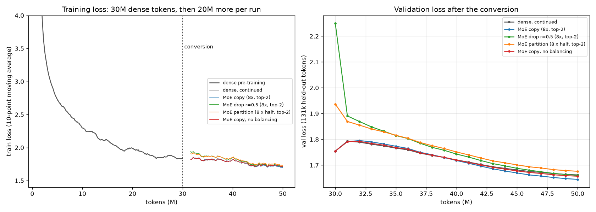
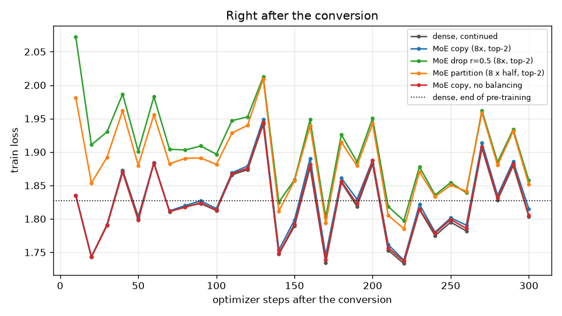
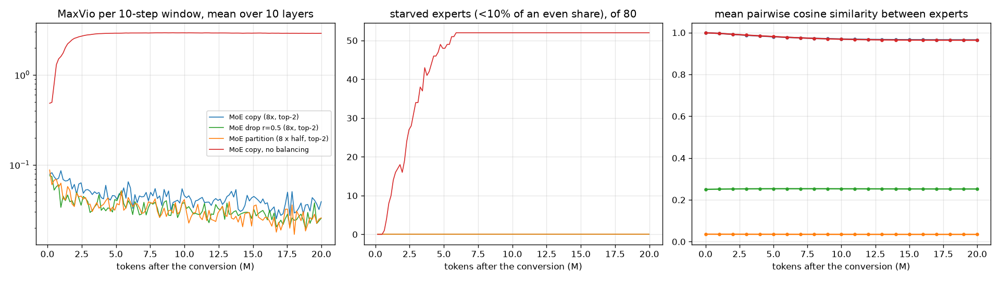
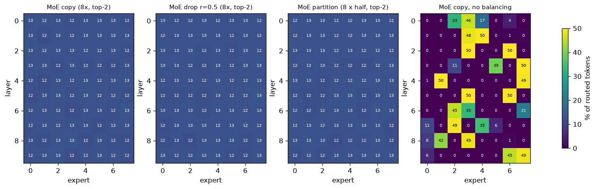

# Dense → Mixture-of-Experts: converting a trained 20M LM and training it on

I trained a 20.8M-parameter dense language model on 30M tokens of TinyStories. Then I converted its feed-forward
blocks into **8 experts per layer with a top-2 router**, in three different ways, and kept training every converted model on
the **same next 20M tokens** as a dense control. All runs used one **RTX 4060 Laptop GPU (8 GB)**, and the notebook also runs on Colab.
Every number below comes from the JSON logs in `results/`, and the full plain-text training logs are in [`logs/`](logs/).

## Results

| run | total params | active / token | val loss at conversion | **val loss after +20M tokens** | vs dense | median tok/s |
|---|---|---|---|---|---|---|
| dense, continued (control) | 20.8M | 20.8M | 1.7546 | **1.6624** | — | 65,794 |
| **MoE copy** (8 × full copy, top-2) | 103.5M | 32.7M | **1.7546** (identical) | **1.6449** | **−0.0175** | 22–31k |
| MoE drop-upcycle (r = 0.5) | 103.5M | 32.7M | 2.2503 | 1.6606 | −0.0018 | 22,247 |
| MoE partition (8 × half width, top-2) | 56.3M | **20.9M** (same as dense) | 1.9368 | 1.6764 | +0.0140 | 36,695 |
| MoE copy, **no load balancing** | 103.5M | 32.7M | 1.7546 | 1.6572 | −0.0052 | 22,151 |

Validation loss is measured on the same 131k held-out tokens (TinyStories validation split) every 1M training tokens.
The dense model reached 1.7546 after its 30M pre-training tokens.

The short version:

* **All four converted models kept training and their loss kept going down.** Every MoE run finished well below the
  1.7546 it started from, and each one's lowest validation loss was at its last evaluation (§3, `logs/moe_*.log`).
* **Copy-upcycling is lossless at the moment of conversion.** The MoE model's validation loss was 1.75461 against the dense model's 1.75463.
  Every expert is the same MLP and the top-2 weights add up to one, so the output cannot change (§2).
* **It is also the only conversion that clearly beat the dense control**: 1.6449 against 1.6624 after 20M more tokens.
  But it uses 1.6× the active parameters per token, and with my simple expert loop it trained about 3× slower.
* **Drop-upcycling and partitioning pay for their head start.** Redrawing half the neurons cost +0.50 in loss at conversion,
  and partitioning cost +0.18. Neither fully caught up in 20M tokens. The partition model is the only one with the dense model's compute per token,
  and it finished 0.014 *worse* than the dense control (§3).
* **Without balancing, the router collapsed within ~3M tokens.** In every layer, nearly all tokens went to 2 or 3 of the 8 experts, and 52 of the
  80 experts got under 10% of an even share. The auxiliary-loss-free bias kept every expert in every layer between 11.8% and 13.4% of the load, against an even 12.5% (§4).
* **Copied experts stay copies for a long time.** Their mean pairwise cosine similarity only fell from 0.999 to 0.965 in 20M tokens (§4).



---

## 1. Setup

| | |
|---|---|
| Data | TinyStories (`roneneldan/TinyStories`): the first 234k stories streamed, **52M train tokens** and 1M validation tokens |
| Tokenizer | byte-level BPE trained on 100k stories, 8,192 tokens |
| Dense model | decoder-only, 10 layers, width 384, 6 heads of 64, RoPE, RMSNorm, **SwiGLU MLP 384 → 2×1,024 → 384**, tied embedding, **20,848,512 parameters** |
| MoE layer | softmax router (fp32, init std 0.002) → top-2 → weights renormalised to sum to 1; SwiGLU experts; dropless (every routed token is processed) |
| Balancing | auxiliary-loss-free selection bias (Wang et al., 2024): after every step, `b_i += 0.001 · sign(mean load − load_i)`, used only for *choosing* experts |
| Pre-training | 30M tokens, batch 32 × 512, AdamW (0.9, 0.95, wd 0.1), lr 1e-3, 3% warm-up, cosine to 1e-4 |
| Continuation | **the same next 20M tokens for every run** (the data stream picks up where pre-training stopped), fresh AdamW, 3% warm-up to 3e-4, cosine to 3e-5 |
| Precision | bf16 autocast for the matmuls, fp32 router and parameters |
| Hardware | RTX 4060 Laptop GPU 8 GB, Windows 11, PyTorch 2.11 + CUDA 12.8; allocator capped at 92% of the card |

The full-width MoE models (103M parameters) ran out of memory at a micro-batch of 32 sequences. They train with 2 × 16 and
gradient accumulation, so every run still takes the same optimizer steps on the same 16,384 tokens per step.

## 2. The conversion

Attention, embeddings and norms are copied unchanged. Each layer's MLP becomes 8 experts, and each layer gets a new router (`moe/upcycle.py`):

| method | how each expert starts | output scale |
|---|---|---|
| **copy** (sparse upcycling, Komatsuzaki et al., 2022) | an exact copy of the dense MLP | 1 |
| **drop** (Drop-Upcycling, Nakamura et al., 2025) | a copy with a random 50% of its 1,024 inner neurons redrawn from the original matrices' mean and std | 1 |
| **partition** (neuron splitting, as in LLaMA-MoE, Zhu et al., 2024) | a random 512 of the 1,024 neurons (subsets overlap between experts) | 1,024 / 512 = 2 |

Validation loss **at the moment of conversion, before any training** (`results/conversion.json`):

| model | total params | active params | val loss | change |
|---|---|---|---|---|
| dense | 20,848,512 | 20,848,512 | 1.75463 | — |
| MoE copy | 103,454,592 | 32,675,712 | 1.75461 | −0.00002 (bf16 rounding) |
| MoE drop r = 0.5 | 103,454,592 | 32,675,712 | 2.25026 | +0.496 |
| MoE partition | 56,268,672 | 20,879,232 | 1.93679 | +0.182 |

The copy model computes the dense function exactly. Every expert is the same MLP, so whichever two the router picks,
`w₁·E(x) + w₂·E(x) = E(x)` because `w₁ + w₂ = 1`. A side effect is that the router gets **no gradient at first**:
renormalised weights of identical experts don't change the output. The router only starts learning once the copies have
seen different tokens and drifted apart.

The partition model is the compute-matched one. Two experts of 512 neurons are exactly the dense MLP's 1,024 neurons of work per token,
and its active count (20.88M) differs from the dense model only by the routers. Its starting loss is worse because each pair of
random halves overlaps and leaves some neurons out, so the scaled sum only approximates the dense MLP.

## 3. Does it keep training? Yes

Validation loss after the conversion, every 5M tokens (from `results/*.json`; the full curve is every 1M tokens in `logs/`):

| tokens after conversion | 0 | 1M | 5M | 10M | 15M | **20M** |
|---|---|---|---|---|---|---|
| dense, continued | 1.7546 | 1.7933 | 1.7661 | 1.7205 | 1.6816 | **1.6624** |
| MoE copy | 1.7546 | 1.7911 | 1.7734 | 1.7181 | 1.6699 | **1.6449** |
| MoE drop r = 0.5 | 2.2503 | 1.8909 | 1.8149 | 1.7431 | 1.6879 | **1.6606** |
| MoE partition | 1.9368 | 1.8694 | 1.8160 | 1.7512 | 1.7012 | **1.6764** |
| MoE copy, no balancing | 1.7546 | 1.7923 | 1.7684 | 1.7198 | 1.6779 | **1.6572** |

* **Every run's validation loss fell steadily after the first 2M tokens, and every run reached its lowest value at the end.** For example, the
  copy model went from 1.7546 to 1.6449 (−0.110), and the partition model went from 1.9368 to 1.6764 (−0.260).
* **Every run rises for the first ~1M tokens, the dense control included.** The cause is the learning-rate re-warm from 1e-4
  (where pre-training ended) back up to 3e-4, not the conversion. The copy model and the dense control rise by the same amount (to 1.791 and 1.793).
* **The copy model only pulls ahead late.** It is level with the dense control at 10M (1.7181 against 1.7205), and the gap opens to 0.0175 by 20M.
  That fits the copies needing time to become different experts (§4).
* **Drop-upcycling recovers fastest from its bigger hit** (2.25 → 1.89 in the first 1M tokens), but 20M tokens wasn't enough to
  turn its extra diversity into a win over the dense model. The paper's gains come after hundreds of billions of tokens.

The first 300 optimizer steps after the conversion, unsmoothed. The copy model's training loss sits on top of the dense control's, step for step:



## 4. Routing: balance, collapse, and how slowly copies diverge





**With the bias balancing, every expert in every layer got 11.8–13.4% of the routed tokens** over the last steps (an even share is 12.5%).
MaxVio measures how far the busiest expert is above average. Averaged over the 10 layers it stayed under 0.09 for all three balanced runs and
ended around 0.03, and no single layer went above 0.18. No expert was ever dead or starved.
The final biases are small (between −0.025 and +0.052, against scores around 0.125), so they nudge which experts get picked without
overriding the router.

**Without balancing, routing collapsed onto 2 or 3 experts per layer.** MaxVio rose from 0.5 to 2.3 within 100 steps (1.6M tokens) and then
sat near its ceiling of 3.0. That ceiling means two experts take all the tokens, since top-2 needs exactly two. By 6M tokens, 52 of the 80
experts were getting under 10% of an even share. This is the rich-get-richer loop: an expert picked slightly more often gets more gradient,
gets better, and gets picked even more.
The collapsed model still finished 0.005 below the dense control. With copied experts, collapse costs little at first, because every copy is
already a good MLP. What it loses is the capacity: it finished 0.012 behind the balanced copy model, 1.6572 against 1.6449.

**The copied experts stay near-identical.** Their mean pairwise cosine similarity went 0.999 → 0.980 (5M) → 0.969 (10M) → 0.965 (20M). Drop-upcycling starts the
experts at 0.25 similarity, and that barely moved. (For the partition model the 0.035 is not meaningful. It compares *different*
neurons sitting at the same position, so it only says that the experts aren't copies.)

## 5. What the MoE costs

| run | total params | active / token | peak memory | median tok/s | time for 20M tokens |
|---|---|---|---|---|---|
| dense | 20.8M | 20.8M | 4.98 GiB (batch 32) | 65,794 | 5.1 min |
| MoE copy / drop | 103.5M | 32.7M | 5.43 GiB (2 × 16) | ~22,000 | ~15 min |
| MoE partition | 56.3M | 20.9M | 6.79 GiB (batch 32) | 36,695 | 9.1 min |

* Memory follows the **total** parameters: the full-width MoE has 5× the parameters and needed half the micro-batch.
* The MoE runs are slower than their active parameters suggest. The partition model does the same FLOPs per token as the dense model and still
  ran at 0.56× the speed. My MoE layer is a plain Python loop over 8 experts, with an argsort, a gather and an `index_add` around it. At this
  tiny width, that overhead is a large share of the step. Grouped GEMM kernels such as MegaBlocks remove most of it.
* So at equal **wall-clock** time the dense model would have seen 2–3× more tokens. The copy model's 0.0175 win is at equal tokens, not equal compute.

## 6. Things I got wrong or had to work around

* **First memory test ran out of memory.** I sized the MoE runs from the dense model's batch of 32. A 103M-parameter MoE with AdamW
  doesn't fit that on 8 GB, so I added gradient accumulation (2 × 16).
* **The laptop went to sleep twice during the copy runs.** That shows up in the logs as windows of 15 and 50 tok/s, and as a 4-hour wall
  time for one run. The numbers above therefore use the **median** over 10-step windows. Even so, the `moe_copy` run's windows fall into
  two groups, at about 21k and 32k tok/s, before and after a sleep. That is the same model as `moe_drop`, which ran at 22k, so treat
  speed differences under about 40% as noise on this laptop.
* **Copy-upcycling gives the router nothing to learn from at first** (§2). I knew identical experts would start identical, but I
  hadn't expected the router to get exactly zero gradient through the renormalised weights until the experts drift apart.
  Adding small noise to the copies would break the tie earlier. That is roughly what drop-upcycling does, at a much larger scale.

## 7. Limitations

* **One seed per run.** I didn't measure seed-to-seed spread, so the −0.0018 (drop) and −0.0052 (no balancing) gaps may well be noise.
  The copy model's −0.0175 is the only gap large enough that I'd put weight on it.
* **Small scale and a short continuation.** 20M tokens after the conversion is far below what the upcycling papers use. Their gains for
  drop-upcycling over plain copying appear much later in training.
* **No MoE trained from scratch** with the same budget, so I can't say where upcycling stops paying off at this size.
* The simple expert loop makes the speed comparison unfavourable to the MoE models (§5).

## 8. Reproduce

```bash
pip install -r requirements.txt
python run_experiments.py          # all six runs, in order; finished runs are skipped
```

or open **`dense_to_moe.ipynb`** (Colab-ready, executed outputs committed). It clones the repo, prepares the data, trains or loads every run,
checks the conversion, and draws the figures.

```
moe/
  data.py          TinyStories -> BPE -> uint16 token files, random-window loader
  model.py         dense / MoE decoder-only LM, router, bias balancing, Switch aux loss option
  upcycle.py       dense -> MoE conversion (copy, drop, partition), expert similarity
  train.py         training loop; writes logs/<run>.log, results/<run>.json, checkpoints/<run>.pt
  experiments.py   the six runs and their settings
  report.py        figures and the summary table
logs/              plain-text training logs, one line every 10 steps and every 1M-token evaluation
results/           JSON logs, conversion.json, summary.json, samples.json, figures
```

A training log line looks like this (from `logs/moe_copy.log`):

```
step  1200/1220 | tokens  19.66M | loss 1.6839 | lr 3.02e-05 | gnorm 0.39 |  22,231 tok/s | maxvio mean 0.04 max 0.06 | dead 0/80 | starved 0
eval step  1220 | tokens  19.99M | val loss 1.6449 | expert cos-sim 0.965
```

## References

* Komatsuzaki et al., *Sparse Upcycling: Training Mixture-of-Experts from Dense Checkpoints*, 2022.
* Nakamura et al., *Drop-Upcycling: Training Sparse Mixture of Experts with Partial Re-initialization*, 2025.
* Zhu et al., *LLaMA-MoE: Building Mixture-of-Experts from LLaMA with Continual Pre-training*, 2024.
* Wang et al., *Auxiliary-Loss-Free Load Balancing Strategy for Mixture-of-Experts*, 2024.
* Fedus, Zoph, Shazeer, *Switch Transformers*, 2021.
* Eldan and Li, *TinyStories*, 2023.
